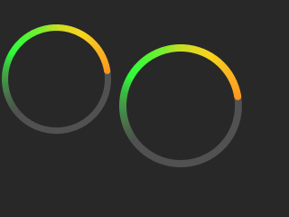

# Creality SpacePi X4 Custom Firmware (`3.0.1_0`) & Reverse Engineering Suite

An open-source reverse engineering, binary analysis, and custom firmware build framework for the **Creality SpacePi X4** dual-chamber filament dryer (`DB-05` hardware platform).
> [!WARNING]
> **HARDWARE IS CAPABLE OF HIGHER TEMPERATURES, BUT EXTENSIVE TESTING HAS NOT FINISHED**
THERE BE DRAGONS AHEAD

> [!NOTE]
> **Base Firmware Policy:** The latest official 1st-party release (**`v0.2.9_3.1_cspx4.lcd`**, MCU build `"Jun  1 2026"` + refactored UI `"_3.1"`) is the official working framework for all custom firmware builds and future revisions. Older firmware versions have been moved to `firmware/FW_Archive/` and are fully cataloged in `docs/` and `extracted/` for reference. All custom firmware files append `*_cfw` before the `.lcd` extension, with prior custom builds archived in `firmware/CFW_Archive/`.

---

## Custom Firmware `3.0.1_0` (`v3.0.1_0_cspx4_cfw.lcd`)

Built directly on top of the official **`v0.2.9_3.1_cspx4.lcd`** base, custom firmware **`3.0.1_0`** (reported as **`V3.0.1_0`** on the About screen) incorporates:

### 1. `95°C` (`203°F`) Maximum Temperature Ceiling (Up from `90°C` / `194°F`)
- **HMI Display / UI Partition (`0x310054`):**
  - Updates master global variable `var_0x0020` (`max_temp_c`) at file offset `0x310054` from `90` (`0x5A`) to **`95` (`0x5F`)**.
  - **Seamless UI Integration:** Because `v0.2.9_3.1_cspx4` derives all UI temperature limits from `var_0x0020`:
    - **Celsius Mode (`temp_zh == 0`):** Sets `max_temp` (`var_0x013c`) to **`95°C`** and dynamically populates keypad prompts across all 10 languages as **`"Input range: 45~95"`**.
    - **Fahrenheit Mode (`temp_zh == 1`):** Global conversion subroutines `sub 0` (`0x3110F4`) and `sub 1` (`0x3111A0`) dynamically evaluate `(95 * 18 + 320) / 10 = 203`, setting `max_temp` (`var_0x013c`) to **`203°F`** and formatting keypad prompts as **`"Input range: 113~203"`**.
    - **All Screens Supported:** Keypad `OK` clamping (`Page 6`/`7`), `+` increment buttons, Manual/Preset Drying (`Page 8`), Auto Drying (`Page 14`/`15`/`16`), and "My Drying" custom presets (`Page 28`) all accept up to **`95°C` (`203°F`)** with zero deviation from the stock UI scheme.
- **Microcontroller (MCU) Partition (`0x3F256C` base):**
  - Updates the target-temperature validation loop (`0x080058D4`):
    - `.lcd` `0x3F3E4A` (`mcu.bin+0x18DE`): `5A 25` (`MOVS R5, #90`) → **`5F 25` (`MOVS R5, #95`)**
    - `.lcd` `0x3F3E60` (`mcu.bin+0x18F4`): `5A 2A` (`CMP R2, #90`) → **`5F 2A` (`CMP R2, #95`)**
  - **Full Thermal Safety & Fault Reporting Preserved (`[E01]`, `[E02]`, `[E03]`, `[E04]`):**
    - All chamber thermal fault checks in the MCU (`0x08006458..0x080064E0` Left, `0x0800685E..0x080068EA` Right, `0x08006780`, `0x08006A30`) are computed dynamically relative to `Target_Temp`:
      - **`[E01L/R]` (Chamber Outlet Temp Too High):** Triggers at `PTC_Temp > Target_Temp + 19.5°C` (**`114.5°C`** at a `95°C` setpoint) or `AHT_Temp >= Target_Temp + 8.0°C` (**`103.0°C`** at a `95°C` setpoint).
      - **`[E02L/R]` (PTC NTC Thermal Runaway / Sensor Fault):** Absolute `140.0°C` (`#1400` tenths at `0x08005FE0`/`0x0800601E`) and `-10.0°C` open-circuit cutoffs remain active with a `25.5°C` margin above the `114.5°C` `[E01]` threshold.
      - **`[E03L/R]` (Abnormal Heating / Lid Open):** Checks `AHT_Temp < Target_Temp - 5.0°C` (**`90.0°C`** at a `95°C` setpoint) after `900` seconds (`15` minutes).
      - **`[E04L/R]` (AHT20 Sensor Timeout):** Unchanged.

### 2. Full Native `320×240` (`1×1` Pixel, 16-Bit RGB565) Custom Splash Screen
- Stores the full native `320×240` (`1×1` pixel, 16-bit RGB565) custom splash image (`Pic 81`, `1,902` RLE blocks = `41,882` bytes) in the `61,058`-byte unused zero-padding region (`0x301180..0x30B51A`) between the Font section and the Code section (`0x310000`).
- **Preserves Heating Gauge Assets (`Pic 0..80`):** `Pic 0` through `Pic 80` are the dynamic circular temperature-gauge ring states (`0°C` to `80°C`) for the active drying chambers. Leaving `Pic 0..80` completely factory-original guarantees clean, artifact-free gauge rings at all drying temperatures (`0°C .. 95°C`).
- Eliminates all horizontal pixel grouping (`2×1`/`3×1`) and color posterization, while keeping all 218 picture descriptors valid.

### 3. Boot Process Disclaimer Notice
- Displays the required notice **`"ALPHA FIRMWARE: NO WARRANTY, EXPRESS OR IMPLIED"`** prominently on the boot splash screen (`Pic 81`, held on `Page 0` for `2,000 ms` during startup) in crisp amber text (`y = 227..233`) along the bottom margin.

| Clean 65°C Chamber Gauge (`Pic 65`) | Native `1×1` Custom Splash + Disclaimer (`Pic 81`) |
| :---: | :---: |
|  |  |

### 4. Firmware Version `3.0.1_0` (MCU + HMI UI)
- **MCU Partition:**
  - `.lcd` `0x3F6F2C` (`mcu.bin+0x49C0`): Version tuple `00 02 09 00` (`0.2.9`) → **`03 00 01 00` (`3.0.1`)**.
  - `.lcd` `0x3F6F4E` (`mcu.bin+0x49E2`): Boot banner outputs `"Software version: V3.0.1, Date:Jun  1 2026\r\n"`.
- **UI Partition:**
  - `0x312BDD` (`sub 6`): Retains `"V"` prefix so `str_0x00a2` evaluates to **`"V3.0.1"`**.
  - `0x3517D3` (`Page 19` About Screen): Pre-populates `str_0x288d` default text with **`"V3.0.1_0\0"`**.
  - `0x351852` (`Page 19` About Screen): Updates static UI suffix `str_0x2945` (`"_3.1"` → `"_0\0\0"`) so `str_0x288d = str_0x00a2 + str_0x2945` displays **`"V3.0.1_0"`**.

---

### `v3.0.1_0_cspx4_cfw.lcd` Exact Binary Patch & Checksum Table

| Subsystem | `.lcd` Offset | Partition Offset | Original Bytes (`v0.2.9_3.1`) | Patched Bytes (`3.0.1_0`) | Description |
| :--- | :--- | :--- | :--- | :--- | :--- |
| **UI Max Temp (`var_0x0020`)** | `0x310054` | `ui.bin+0x310054` | `5A 00 00 00` (`90`) | `5F 00 00 00` (`95`) | Master UI ceiling (`95°C` / `203°F` across all pages & keypads) |
| **MCU Max Temp (`MOVS R5, #95`)** | `0x3F3E4A` | `mcu.bin+0x18DE` | `5A 25` (`MOVS R5, #90`) | `5F 25` (`MOVS R5, #95`) | MCU target temperature clamping value in `0x080058D4` loop |
| **MCU Max Temp (`CMP R2, #95`)** | `0x3F3E60` | `mcu.bin+0x18F4` | `5A 2A` (`CMP R2, #90`) | `5F 2A` (`CMP R2, #95`) | MCU target temperature upper-bound check (`95°C`) |
| **MCU Version Tuple** | `0x3F6F2C` | `mcu.bin+0x49C0` | `00 02 09 00` (`0.2.9`) | `03 00 01 00` (`3.0.1`) | Reported via UART cmd `0x03` and boot banner |
| **MCU Version Prefix** | `0x3F6F4E` | `mcu.bin+0x49E2` | `56` (`'V'`) | `56` (`'V'`) | `"Software version: V3.0.1, Date:Jun  1 2026\r\n"` |
| **UI Version Prefix (`sub 6`)** | `0x312BDD` | `ui.bin+0x312BDD` | `56` (`'V'`) | `56` (`'V'`) | Formats `str_0x00a2` as `"V" + major + "." + minor + "." + patch` (`"V3.0.1"`) |
| **UI About Initial Version** | `0x3517D3` | `ui.bin+0x3517D3` | `00 00 00 00 00 00 00` | `56 33 2E 30 2E 31 5F 30 00` | Sets `Page 19` (`str_0x288d`) initial string to `"V3.0.1_0"` |
| **UI About Version Suffix** | `0x351852` | `ui.bin+0x351852` | `5F 33 2E 31` (`"_3.1"`) | `5F 30 00 00` (`"_0"`) | Suffix `str_0x2945` so `Page 19` displays `"V3.0.1_0"` |
| **Native 1×1 Splash (`Pic 81`)** | `0x301180` | `ui.bin+0x301180` | `00 00 00 00...` (padding) | `41,882` B (`1,902` blks) | Native `320×240` (`1×1` pixel, 16-bit RGB565) custom splash + disclaimer |
| **Pic 81 Descriptor** | `0x0551E5` | `ui.bin+0x0551E5` | `7A 35 1D 00` (`relOff`) | `4F C7 2A 00` (`relOff=0x2AC74F`) | Points Pic 81 descriptor to `0x301180`, `len=41882` |
| **MCU Partition CRC-32** | `0x000008` | `ui.bin+0x000008` | `0xE04812FF` | `0xC4752E90` | `nextion_crc_bytes(mcu_bin)` |
| **Header Block 1 CRC-32** | `0x0000C4` | `ui.bin+0x0000C4` | `0x28AA5B32` | `0xBAC603C1` | `nextion_crc_bytes(data[0x00:0xC4])` |
| **Header Block 2 CRC-32** | `0x00018C` | `ui.bin+0x00018C` | `0x35F9333A` | `0x35F9333A` | `nextion_crc_bytes(data[0xC8:0x18C])` |
| **UI Master CRC-32 (`^ 0x66`)** | `0x3F2568` | `ui.bin+0x3F2568` | `0x2A48BFCA` | `0x167B8BD2` | `nextion_crc_bytes(data[0x00:0x3F2568]) ^ 0x66` |

---

## Official Firmware Evolution Summary (`v0.2.5_0.5` → `v0.2.9_3.1_cspx4`)

| Firmware File | Container Size | Header Magic | UI Size | MCU Size | MCU Build Date | Max Temp | Max Manual Dry Time | Key Changes |
| :--- | :--- | :--- | :--- | :--- | :--- | :--- | :--- | :--- |
| `v0.2.5_0.5.lcd` | `4,440,664` B | `CT2E` (`0x0100`) | `4,419,944` B | `20,720` B | `Sep 29 2025` | `85°C` (`185°F`) | `48h` (`2880m`) | Baseline release |
| `v0.3.0_0.7.lcd` | `4,441,828` B | `CT2E` (`0x0100`) | `4,421,092` B | `20,736` B | `Dec  3 2025` | `90°C` (`194°F`) | `48h` (`2880m`) | `90°C` limit, hybrid hour/min timer, cover filter, UART telemetry |
| `v0.3.0_0.8.lcd` | `4,441,816` B | `CT2E` (`0x0100`) | `4,421,080` B | `20,736` B | `Dec 18 2025` | `90°C` (`194°F`) | `48h` (`2880m`) | Fixes UI lag after switching languages (`Page 17` removed redundant `wepo 0,90`) |
| `v0.2.9_1.1_cspx4.lcd` | `4,444,236` B | `CT2E` (`0x0100`) | `4,421,392` B | `22,844` B | `Jun  1 2026` | `90°C` (`194°F`) | `48h` (`2880m`) | Major MCU expansion (`+2,108` B: per-chamber fault hysteresis, 55-entry fan ramp table); Auto Dry increased from `8h` to `12h` (`720m`) |
| `v0.2.9_3.1_cspx4.lcd` | `4,161,192` B | `DT` (`0x01F7`) | `4,138,348` B | `22,844` B | `Jun  1 2026` | `90°C` (`194°F`) | `48h` (`2880m`) | **Official 1st-party base**: `-283 KB` UI bytecode refactoring into 8 global subroutines (`sub 0..7`), 35 pages, 218 pictures |
| **`v3.0.1_0_cspx4_cfw.lcd`** | **`4,161,192` B** | **`DT` (`0x01F7`)** | **`4,138,348` B** | **`22,844` B** | **`Jun  1 2026`** | **`95°C` (`203°F`)** | **`48h` (`2880m`)** | **Custom firmware: `95°C`/`203°F` max temp (UI+MCU), native `1×1` `320×240` splash, boot disclaimer notice, version `3.0.1_0`** |

---

## Building & Installing `v3.0.1_0_cspx4_cfw.lcd`

### Build from Source
1. Place the official base firmware `v0.2.9_3.1_cspx4.lcd` into `firmware/`.
2. Run the Node.js builder script:
   ```bash
   node scripts/build_3.0.1_0.js
   ```
3. The script outputs:
   - `firmware/v3.0.1_0_cspx4_cfw.lcd` (`4,161,192` bytes, ready to flash)
   - `extracted/v3.0.1_0_cspx4_cfw_ui.bin` & `extracted/v3.0.1_0_cspx4_cfw_mcu.bin`
   - `extracted/v3.0.1_0_splash_preview.png` & `extracted/v3.0.1_0_pic65_gauge_preview.png`

### Flash onto SpacePi X4
1. Format a microSD card as **FAT32** (`4096`-byte allocation unit size recommended).
2. Copy `firmware/v3.0.1_0_cspx4_cfw.lcd` to the root directory of the microSD card (ensure it is the **only** `.lcd` file on the card).
3. Power off the SpacePi X4, insert the microSD card into the display slot, and power the unit on.
4. Wait for the TJC bootloader transfer and MCU update to complete, then remove the microSD card and power-cycle if prompted.

---

## Repository Structure
- `docs/` — Architectural documentation, binary memory maps, and LLM operational guidelines:
  - [`MEMORY_BANK.md`](docs/MEMORY_BANK.md): Project status, primary discoveries, and completed milestones.
  - [`BINARY_MAP.md`](docs/BINARY_MAP.md): Container header (`CT2E` / `DT`), checksums, HMI picture table (`0a600103` RLE), and ARM Cortex-M flash/RAM layout.
  - [`EXTRACTION_REPORT.md`](docs/EXTRACTION_REPORT.md): Comprehensive 5-version factory diff and `3.0.1_0` custom firmware specification.
  - [`LLM_PROMPT_BOOK.md`](docs/LLM_PROMPT_BOOK.md): Operational guidelines for AI-assisted firmware analysis.
- `scripts/` — Analysis, extraction, and custom firmware build utilities:
  - [`build_3.0.1_0.js`](scripts/build_3.0.1_0.js): Builds active custom firmware `v3.0.1_0_cspx4_cfw.lcd` from `v0.2.9_3.1_cspx4.lcd`.
  - [`build_A3.0.0.js`](scripts/build_A3.0.0.js): Builds custom firmware `A3.0.0_cspx4_cfw.lcd` from `v0.2.9_3.1_cspx4.lcd`.
  - [`extract.py`](scripts/extract.py): Unpacks `.lcd` firmware containers into UI and MCU partitions.
  - [`diff_mcu.py`](scripts/diff_mcu.py): Performs binary region diffing across MCU payloads.
  - [`patch_splash.py`](scripts/patch_splash.py): Legacy in-place `Pic 81` RLE splash patcher and `CT2E` CRC-32 verifier.
- `firmware/` — Target `.lcd` firmware images:
  - `v0.2.9_3.1_cspx4.lcd` — Official 1st-party base working framework.
  - `v3.0.1_0_cspx4_cfw.lcd` — Active latest custom firmware.
  - `FW_Archive/` — Archived older factory releases (`v0.2.5_0.5`, `v0.3.0_0.7`, `v0.3.0_0.8`, `v0.2.9_1.1`).
  - `CFW_Archive/` — Archived older custom firmware builds (`3.0.1_0_cspx4_cfw`, `A3.0.0_cspx4_cfw`, etc.).
- `extracted/` — Output directory for carved partitions, CSV exports, and decoded splash previews.
