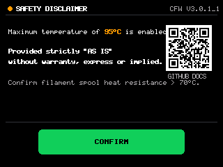

# Creality SpacePiX4 Custom Firmware & Reverse Engineering Suite #
# (`Current_Ver 3.0.1_1` — Development Branch) #

An open-source *LLM-led* reverse engineering, binary analysis, and custom firmware build framework for the **Creality SpacePiX4** dual-chamber filament dryer (`DB-05` hardware platform).

> [!WARNING]
> **DEVELOPMENT VERSION (`dev` branch) — USE AT YOUR OWN RISK**
>
> **HARDWARE IS CAPABLE OF HIGHER TEMPERATURES, BUT EXTENSIVE TESTING HAS NOT FINISHED.**
>
> **NO WARRANTY IS PROVIDED, EXPRESS OR IMPLIED. IF YOUR HOUSE BURNS DOWN, YOUR CAR WONT START, OR YOUR FROGS TURN GAY (*they always were*) DONT BLAME ME**
> 
> **THERE BE DRAGONS AHEAD**

> [!NOTE]
> **Base Firmware** — A beta revision provided by Creality (**`v0.2.9_3.1_cspx4.lcd`**, MCU build `"Jun  1 2026"`) is the official working framework for all custom firmware builds.
>
> Prebuilt firmware container binaries (`.lcd`) are **not** distributed in this repository. Users build custom firmware locally from the official base firmware using the provided Node.js scripts.
>
> This process can be reversed by flashing the device via Micro SD card slot with a retail or beta firmware provided by Creality. The latest retail firmware is available [HERE](https://www.creality.com/download/creality-spacepi-x4).

---

## Custom Firmware `3.0.1_1` (Development Build)

This development release adds the pre-boot Safety Disclaimer interception screen and clean native custom boot splash:

### 1. `95°C` (`203°F`) Maximum Temperature Range (Up from `90°C` / `194°F`)
- **HMI Display / UI Partition (`0x310054`):**
  - Master UI temperature limit `var_0x0020` updated from `90` (`0x5A`) to **`95` (`0x5F`)**, dynamically scaling all keypad inputs (`45~95°C`, `113~203°F`), clamp logic, and drying modes.
- **Microcontroller (MCU) Partition (`0x3F256C` base):**
  - MCU target-temperature validation loop clamped at `95°C` (`MOVS R5, #95` at `0x3F3E4A` & `CMP R2, #95` at `0x3F3E60`).
  - All hardware thermal safety checks and fault reporting (`[E01]`, `[E02]`, `[E03]`, `[E04]`) remain 100% active.

### 2. Clean Custom Boot Splash (`Pic 81`)
- Native `320×240` 1×1 resolution 16-bit RGB565 custom splash image without progress bar or text overlays.
- Display duration extended to 3,000 ms.

### 3. Full-Screen User-Accepted Safety Disclaimer (`Page 31` / `Pic 118`)
- Intercepts boot process with a full 4:3 `320×240` Safety Disclaimer dialog before entering the operating dashboard.
- Displays 95°C capability notice, bold legal disclaimer, filament spool heat tolerance warning, and GitHub QR code.
- Requires user touch acknowledgement via the Creality green `CONFIRM` button before loading the operating dashboard.
- Operating dashboard remains completely factory-original and untouched.

| Clean Custom Splash (`Pic 81`) | Safety Disclaimer Dialog (`Pic 118`) |
| :---: | :---: |
|  |  |

---

## Building `v3.0.1_1_cspx4_cfw.lcd` from Source

1. Place the official base firmware `v0.2.9_3.1_cspx4.lcd` into `firmware/`.
2. Run the Node.js builder script:
   ```bash
   node scripts/build_3.0.1_1.js
   ```
3. The script generates:
   - `firmware/v3.0.1_1_cspx4_cfw.lcd` (`4,161,192` bytes, ready to flash)
   - Decoded preview images in `extracted/` for verification

---

## Flashing Instructions

1. Format a microSD card (32 GB or smaller) as **FAT32** (`4096`-byte allocation unit size recommended).
2. Copy the locally built `firmware/v3.0.1_1_cspx4_cfw.lcd` to the root directory of the microSD card (ensure it is the **only** `.lcd` file on the card).
3. Power off the SpacePi X4, insert the microSD card into the display slot, and power the unit on.
4. Wait for the TJC bootloader transfer and MCU update to complete, then remove the microSD card and power-cycle.
5. Upon boot, review the Safety Disclaimer and tap **CONFIRM** to enter the dashboard.
